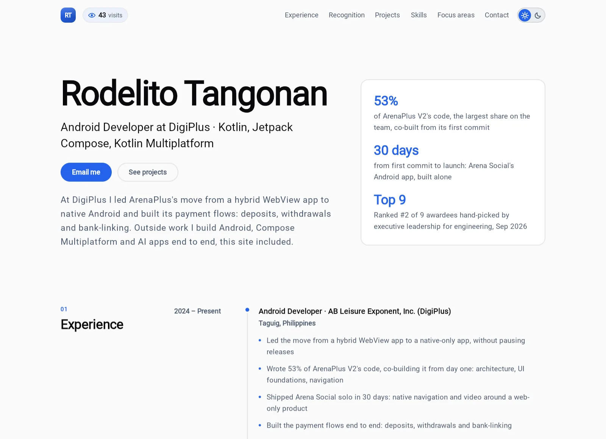

# AboutYowkey

The portfolio of **Rodelito Tangonan**, Android developer. It is built so that a recruiter who gives it seven seconds
still leaves knowing who I am, what I have shipped and how to reach me.

**Live:** https://aboutyowkey.pages.dev/

## What it is

One page, read from top to bottom, with a page of its own for each project. The site is also a work sample: it is
written entirely in Kotlin with Compose Multiplatform, the way I build Android apps, and the same code runs in the
browser, as a desktop window and as an app on my phone.

## The hierarchy

Each section is placed by what a hiring manager wants to know next. From the top:

1. **The first screen.** My name and role on the portrait's stage, my stack under it, and three numbers that prove
   it, each with the sentence behind it. Then **Email me** and **See projects**. Nothing that
   matters sits below the fold, and the summary comes after the buttons so it can never push them down.
2. **Experience.** My roles, newest first, with what I did and what it changed.
3. **Recognition.** Awards and honours, each with when and what it was for.
4. **Projects.** Professional work first, then personal projects. Each card answers three questions at a glance:
   what it looks like, what it is, and what it is built with and where it runs. A tap opens the project's own page,
   with its highlights, how it is built, its screens and clips, and its links.
5. **Skills** and **Focus areas.** Short and grouped. They come after the proof, not before it.
6. **Contact.** Email and profiles first. Below them, a private message form, then notes and star ratings left by
   visitors.

## Highlights

- **Proof in the top bar.** While the first screen is up, the bar shows the visitors' average rating and the visit
  count. Once my name scrolls away, the bar shows my name and role instead.
- **A portrait with a voice.** My photo, cut out of its background, dashes in from the left onto a stage in the
  site's blue, a trail of echoes melting into waves behind it, and "screams" as it lands; then my name and the rest
  of the first screen read in after it. It screams again each time it comes into view or a pointer moves over it.
- **Work told without secrets.** Code written for an employer belongs to the employer, so professional projects
  show my role, my share of the work and what it changed, never internal names or code.
- **Projects you can see move.** Real screens and 60 fps clips of the apps, a full-screen viewer, and a page per
  project that can be linked to directly.
- **Real social proof.** Visitors can leave a public note with a star rating, and the page shows the average and
  how the stars spread. Visits are counted without storing anyone's address.
- **A private line.** The message form reaches only me, and my phone app tells me about each message, each note and
  the day's numbers.
- **Readable by everyone.** A plain HTML copy of the page shows first, so search engines, link previews, screen
  readers and older browsers get all of it. There are light and dark themes, the motion follows the system's
  "reduce motion" setting, text contrast meets WCAG AA, and lines stay at a comfortable reading length.

## What I think matters in a portfolio

These ideas shaped every choice above:

- **Lead with proof, not adjectives.** "53% of the app's code, written by me" says more than "passionate
  developer". Every claim on the first screen is a number with the sentence behind it.
- **Design for the skim.** The first screen answers who, what, where, why me and how to reach me. Everything after
  it is for the reader who wants more.
- **Order by what the reader weighs.** Experience and results come before side projects, and skills come last,
  because by then the projects have shown them.
- **Show, don't tell.** Real screens of real apps, and a site that is itself built with the skills it lists.
- **Respect confidentiality.** Describe your part and what it changed, never your employer's internals.
- **Make contact effortless.** The email button is the first button, and sending a message needs no account.
- **One touch of personality.** A single playful element, the portrait, makes the page memorable without getting in
  the way of reading.
- **Keep the words apart from the code.** Every word on the site lives in one file. Editing it and pushing
  redeploys the site, and the build refuses to ship a broken page.

## Built with

Kotlin and Compose Multiplatform (WebAssembly in the browser, the JVM on the desktop, Android on the phone), a small
Cloudflare Worker for the visits, notes and messages, and Cloudflare Pages for the site.

For developers: [editing the content, running, deploying, the backend and the phone app](docs/DEVELOPMENT.md),
[how the code is laid out](docs/ARCHITECTURE.md), and [what has been checked for production](docs/READINESS.md).
